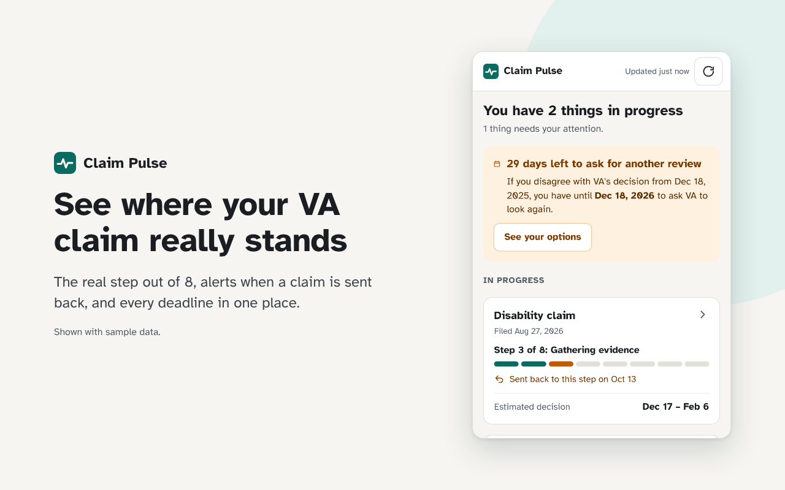
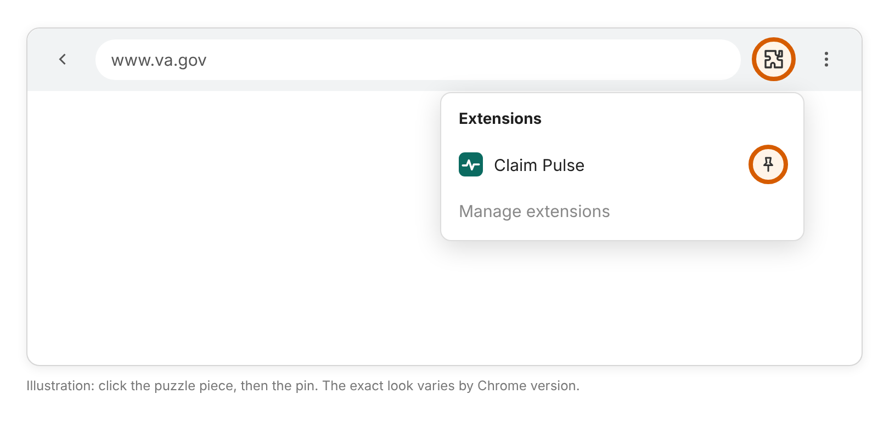
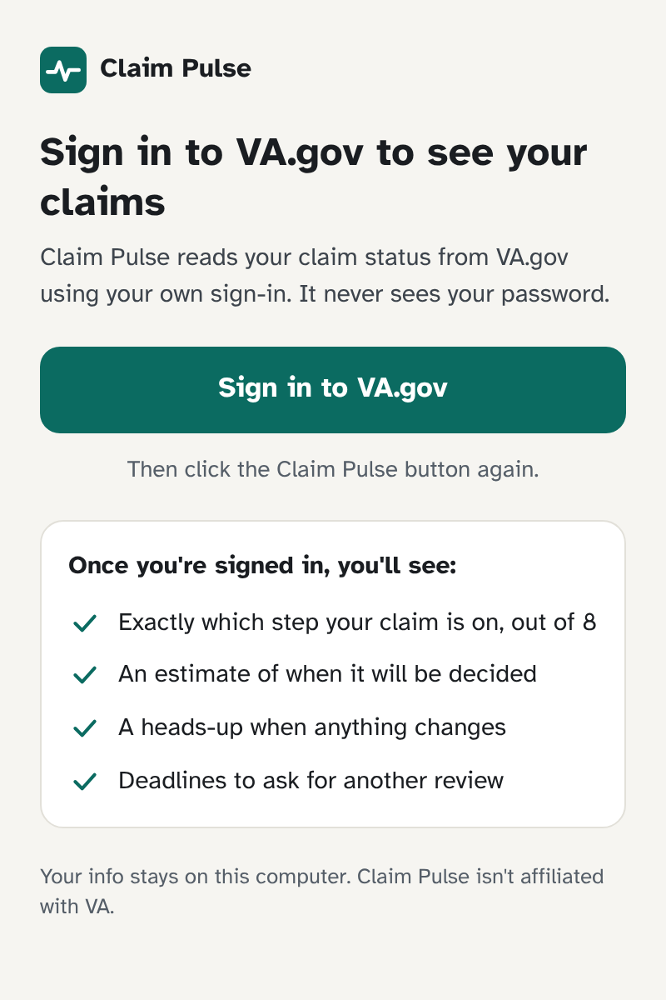

# Claim Pulse

**See where your VA claim really stands.** Claim Pulse is a free Chrome extension that shows the real step your claim is on (out of VA's 8), warns you when a claim gets sent back a step, estimates when it will likely be decided, and counts down your deadlines to ask for another review.

**[Add to Chrome from the Chrome Web Store](https://chromewebstore.google.com/detail/claim-pulse/pjeaeopkjidicbfnaehcnibleklfefbf)** · free · updates automatically

> Not affiliated with, endorsed by, or operated by the U.S. Department of Veterans Affairs. Made by [F4 Software](https://f4software.com).

## What it shows

- **The real step, out of 8.** VA.gov shows 5 steps. VA tracks 8 behind the scenes, and Claim Pulse shows you which one you're on, with a one-line explanation of each.
- **Send-back alerts.** If your claim moved ahead and was sent back (often for another exam), you'll see it, plus how far it got before that.
- **Estimated decision window.** Based on typical step times, VA's published average, and your own past claims. It's labeled as an estimate everywhere it appears.
- **Reviews and appeals.** Supplemental Claims, Higher-Level Reviews and Board Appeals, with day X of VA's goal and an expected date.
- **Deadlines.** After each decision you have 1 year to ask VA to look again. Every open deadline gets a countdown.
- **What changed.** New steps, new exam results, new VA requests and decisions, with a badge and an optional pop-up.

## Install

1. Open **[Claim Pulse in the Chrome Web Store](https://chromewebstore.google.com/detail/claim-pulse/pjeaeopkjidicbfnaehcnibleklfefbf)** and click **Add to Chrome**.
2. Click the puzzle-piece icon next to the address bar, then the **pin** next to Claim Pulse.

   

3. **Sign in to VA.gov** the way you normally do, then click the Claim Pulse icon. Want to look first? Click **See an example with sample data first**.

   

It also works in Microsoft Edge and Brave: open the same store link and click **Add to Chrome** (Edge will ask you to allow extensions from other stores first).

Manual install (only if you can't use the Chrome Web Store)

1. **[Download claim-pulse-1.2.0.zip](https://github.com/joshforcier/claim-pulse/raw/main/download/claim-pulse-1.2.0.zip)** and unzip it. Keep the `claim-pulse` folder somewhere it can stay. It should have `manifest.json` inside.
2. Open `chrome://extensions` and turn on **Developer mode** (top-right switch).
3. Click **Load unpacked** and pick the `claim-pulse` folder.

A manual install doesn't update itself. If you installed this way before, remove it and add the store version so you get updates automatically.

## Privacy

- Uses your own VA.gov sign-in. Claim Pulse never sees your password.
- The only site it contacts is VA's own `api.va.gov`, for your claim status (`/v0/benefits_claims` and `/v0/appeals`).
- Everything it saves stays in your browser on your computer. Nothing is sent to us or anyone else.
- No accounts, analytics, ads or tracking. **Settings → Erase saved claim info** wipes it, and so does removing the extension.

Full policy: [privacy-policy.html](privacy-policy.html). All the code is in [`extension/`](extension) if you want to check for yourself.

## What it can't show

Which VA office (temporary jurisdiction) has your claim. VA removed that from its API, so no extension can show it anymore.

## Questions or problems

Open an [issue](../../issues) or email support@f4software.com.
